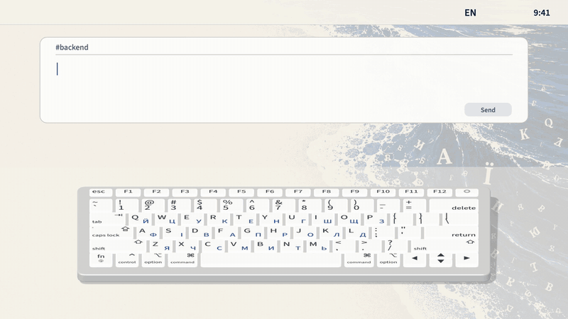

# Anakena

*Gibberish washes up, clean white text stays on the sand.*

A small macOS menu bar app that fixes text typed in the wrong keyboard layout,
between two languages, like the old Punto Switcher. With English / Ukrainian,
type `ghbdsn`, press Space, get `привіт`. The menu bar shows the current language
(`EN`, `УК`, `PL`, etc.).



## The name

Anakena is a white-sand beach on Easter Island (Rapa Nui). By island tradition it is
where the first settlers, led by king Hotu Matu'a, came ashore.

## Requirements

- macOS 13 or newer to run (tested on 26). Building with Xcode 16+ requires macOS 14.5 or newer.
- Swift 6.0+ toolchain: check with `swift --version`. If Swift is missing, `xcode-select --install` may provide it; check the version afterward. If it is still missing or older than 6.0, install Xcode 16+ from the App Store or developer.apple.com.
- Keyboard layouts for at least **two languages** enabled in System Settings → Keyboard → Input Sources.
  With fewer than two, the app does nothing and the menu shows a "⚠︎ Add keyboard layouts…" line.
- macOS spell-check dictionaries for both languages of the active pair.
  Missing dictionaries are shown as a disabled warning in the menu.

There is no prebuilt binary. Every user builds from source on their own Mac.

## Languages

Anakena discovers enabled keyboard layouts and uses the first layout for each language.
On first launch, or if a saved language is no longer enabled, it chooses English /
Ukrainian when both are present. Otherwise it chooses the first two distinct languages,
putting English first when available.

Choose another pair in **Languages** in the menu. The choice is saved on this Mac. The menu
lists every pair with macOS spell-check dictionaries for both languages, matching
regional variants such as `en_US` by their primary language code.

Any pair of enabled keyboard layouts with those dictionaries works: English / Polish,
English / German, Ukrainian / Polish, English / Russian, and others. Input methods
without a keyboard layout table are not supported. Letters come from each layout's
own key table, including Shift and Option characters; composed dead-key sequences
are not tracked. For selected text, the layout that can type more of its letters wins;
if tied (common with shared alphabets), the current layout determines the direction.

## Menu language

The menu follows the macOS language (System Settings → General → Language & Region).
English is the default; Ukrainian is included. Any other language shows English.

To add a translation, copy `Localization/en.lproj` to `Localization/<code>.lproj`
(for example `pl.lproj`), translate the right-hand side of each line in
`Localizable.strings`, keep `%@` and `%ld` as they are, and rebuild. `build.sh` copies every
`.lproj` folder into the app.

## Build and install

```sh
./scripts/make-cert.sh   # once per Mac: local signing identity "Anakena Local Signing"
./build.sh               # makes build/Anakena.app
osascript -e 'quit app "Anakena"'   # quit a running copy first (or choose Quit in its menu)
trash /Applications/Anakena.app      # old copy to the Trash (macOS 15+; or drag it in Finder)
cp -R build/Anakena.app /Applications/
open /Applications/Anakena.app
```

`make-cert.sh` is safe to run again. It makes a self-signed certificate in your login
keychain (macOS may ask for your login password), without sudo or trust changes. On each
build, click "Allow" when codesign asks to use the key, never "Always Allow". Without it `build.sh` signs ad-hoc and
macOS forgets the Accessibility permission after every rebuild. To use another identity:
`SIGN_ID="Apple Development: Name (TEAMID)" ./build.sh`.

Then allow it in **System Settings → Privacy & Security → Accessibility**. It starts
working within a couple of seconds, no relaunch needed. If it still does nothing, also
allow it under **Input Monitoring**. The menu bar item shows `✓ Access granted` when it works.
Run the tests with `swift test`.

## Troubleshooting

- Toggle is on but the menu says `⚠︎ Grant access…`: stale permission entry. In System
  Settings → Privacy & Security → Accessibility (and Input Monitoring) remove Anakena with `−`,
  quit and relaunch the app, add it again and switch it on.
- Nothing happens and the menu says `⚠︎ Secure Input is on`: some app holds Secure Event Input
  (often a password field or a stuck `loginwindow`). Lock and unlock the screen, or restart the Mac.
- Permission lost after a rebuild: you signed ad-hoc. Run `./scripts/make-cert.sh`, rebuild, grant once more.
- Replacing the app while it runs makes macOS reject its signature (`InvalidCode`). Always quit it first (`Quit` in its menu, or `osascript -e 'quit app "Anakena"'`).

## Hotkeys

- **⌃⌥Space** — convert by hand. Undoes the last auto-fix if it was just made;
  otherwise converts the word being typed, or the word just finished, or the selected text.
- **⌃⌥Z** — turn Anakena on / off.

Note: ⌃⌥Space is also the macOS default for "Select next input source". If it clashes,
turn that shortcut off in System Settings → Keyboard → Keyboard Shortcuts → Input Sources.

## How auto-fix decides

When you press Space, Tab or Return, the finished word is converted only if **all** hold:

- it is misspelled as typed (checked in the language of the current layout), and
- the same keys give a correctly spelled word in the other layout, and
- it has at least 3 letters, has no digits and does not look like code (`camelCase`,
  `a/b`, `snake_case`, short ALL-CAPS like `NASA`). A 2-letter word right after a word
  that was just auto-fixed (only spaces between) is checked with the same spelling
  rules; this path leaves single letters alone.

A punctuation key may represent a letter in the other layout (`,elm` → `будь`,
`lzre.` → `дякую`). Both the whole token and the word inside
punctuation are checked; a valid source word keeps its letters (`будь,`, `Привіт.`).
On correction, attached punctuation follows the target layout too. Spelling uses the macOS system
spell checker. The layout is switched too, so you can keep typing. The menu has
"Manual only" if you want hotkeys without auto-fix.

When a word is typed right **or is auto-fixed**, the 1–2 letter words just before it are fixed too if
they are wrong as typed and right in that word's language: `s ot одне` → `і ще одне`.
They must be in the same typing run, separated by one space each, and typed in the
other layout. A convertible short predecessor can also establish context for a
2-letter word: `F nb yt` → `А ти не`; a standalone short word remains unchanged.
One-letter words use a fixed list for English (`a`, `I`) and Ukrainian
(`а б в ж з й і о у я`); other languages have no one-letter retro-fixes.
The run survives a layout switch made right after a space. One Undo restores the
whole group and adds each restored word to the "never" list.

## Learning

Learning lists and menu counts apply to the active language pair. Reset clears learning for every pair.

- Undo of an auto-fix (⌃⌥Space right after it, or the menu) adds the typed word to a
  "never" list; for a group fix, every restored word.
- Converting a single word by hand with ⌃⌥Space when auto-fix skipped it adds it to an
  "always" list (2+ letters, skips the usual rules, but "never" still wins). For a word
  already finished with Space, pressing ⌃⌥Space again converts it back and removes it.
- The latest choice wins. Up to 2000 words per list, stored as lowercased single words
  in the app's preferences on this Mac.
- The menu shows `Learned: N always, M ignored`; `Reset learning` clears both lists.
- Nothing is learned under Secure Input, in ignored apps, or from selections.

## Privacy

Fully local. No network code, no analytics, no cloud. Nothing typed is logged; only
the learned single words above are stored locally in preferences, and no other typed
text is written to disk by Anakena. Memory holds the current word's key buffer, the last
three finished words (for manual conversion and fixing short words), and the last fix's
text for Undo and the menu.
Converting a selection briefly uses the clipboard and restores it only if no one else
has changed it. A clipboard manager may record the copied or converted text despite
the temporary-text marker.
Nothing works in password fields (macOS Secure Input or an AX secure text field).

To uninstall all settings and learned words, run `defaults delete com.leo.anakena`.

## Ignored apps

By default it does not touch terminals, editors, JetBrains IDEs, or remote desktop and
VM apps. Use "Ignore in …" in the menu to add or remove the app you are in.
